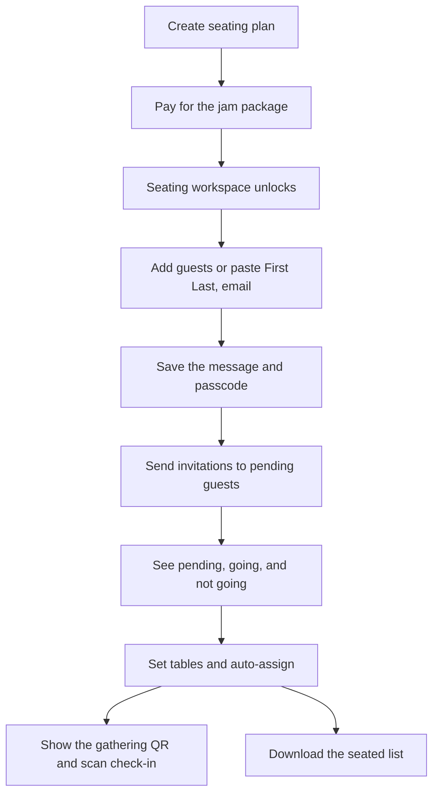
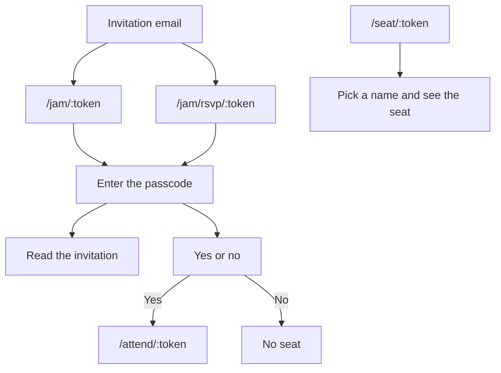

# Jam seating

Jam is the customer-app side of a seating plan that is separate from a wedding event. The host buys a package, invites guests with a passcode, seats the people who are coming, and checks them in. The wedding invitation designer and website builder are not part of this flow.

## Host path

`/user/create-seating` starts a gathering. Payment stays on `/user/seating-payment`. The workspace at `/seating/:gatheringId` stays locked until the gathering is `ACTIVE`.

The workspace uses the same buttons and containers for four sections:

- **Guests.** Add one person, or paste lines shaped as `First Last, email`. Each row has a response of pending, going, or not going. Going is what marks someone attending.
- **Invitation.** Edit the subject, message, and passcode, then send to guests who are still pending. Counts show pending, going, and not going.
- **Tables and seats.** Set the table count and seats per table, auto-assign attending guests, and move someone after. A party sits together when the table has room. Replacing the layout asks before it clears seats.
- **QR and check-in.** Shows the gathering QR, lists attending guests, and scans a personal pass.

**Download seated list** on the guests section saves `jam-guests.csv`.

## Guest path

These pages use the same simple card as the seat pass. They do not require a login. `/jam/` is public in the auth guard, and a host with an unpaid wedding event is not redirected away from it.

- `/jam/:token` asks for the passcode, then shows the message, date, and venue.
- `/jam/rsvp/:token` asks for the passcode, then yes or no.
- `/seat/:token` is the gathering QR. The guest picks their name and sees the table and seat. It does not check them in.
- `/attend/:token` is the personal pass. It shows the seat, or “Your seat is not assigned yet” until one exists. `?checkin=1` records check-in once.

## Where the code lives

- Workspace: `app/pages/seating/[gatheringId].vue`
- Public pages: `app/pages/jam/[token].vue`, `app/pages/jam/rsvp/[token].vue`, `app/pages/seat/[token].vue`, `app/pages/attend/[token].vue`
- API and UI-only mocks: `app/composables/useSeating.ts`
- Types: `app/types/seating.ts`
