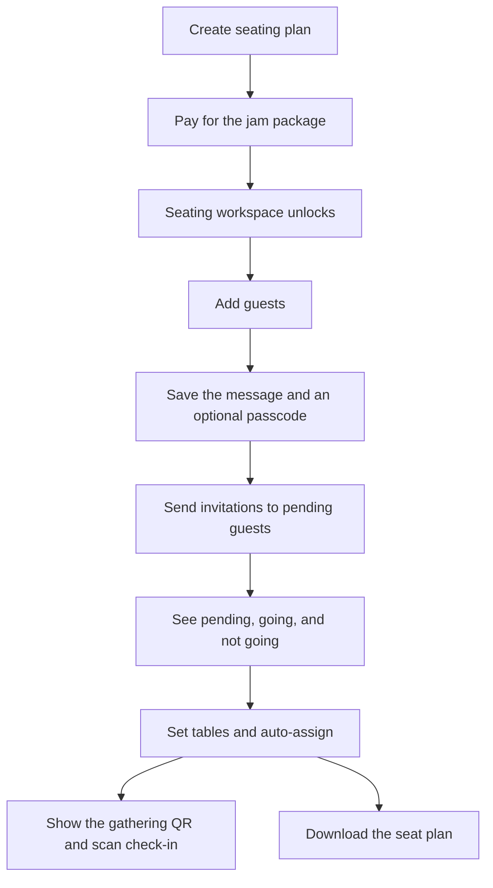
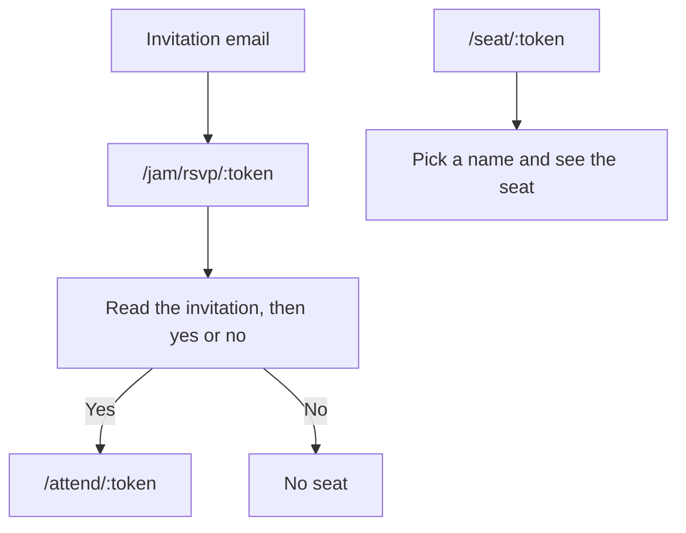

# Jam seating

Jam is the customer-app side of a seating plan that is separate from a wedding event. The host buys a package, invites guests, optionally with a passcode, seats the people who are coming, and checks them in. The wedding invitation designer and website builder are not part of this flow.

## Host path

`/user/create-seating` starts a gathering. Payment stays on `/user/seating-payment`. The workspace at `/seating/:gatheringId` stays locked until the gathering is `ACTIVE`.

The workspace uses the same buttons and containers for its sections:

- **Guests.** Add one person at a time, or paste a list of emails into **Bulk Invite**. A bulk list shows its counts first, including how many credits are left, where credits are the plan's remaining guest slots. Sending is blocked over the limit, with a link to upgrade. Those guests show by email with "Waiting for name" until they reply, and marking one as going by hand asks for their name. A new guest always starts as pending. Each row has a response of pending, going, or not going, which changes when the guest replies or the host records a reply. Going is what marks someone attending.
- **Reusing guests.** A host with another Jam can copy guests from it in the guests section, which opens by itself while the list is empty. They come in as pending, and nothing is sent until the host sends invitations.
- **Invitation.** Edit the subject, message, and passcode, add custom RSVP questions, then send to guests who are still pending. Counts show pending, going, and not going. Guest rows show each guest's answers, and the seat plan has a column per question.
- **Invitation design.** In the invitation section, the host sets a request line, headline, time, RSVP deadline, colors, fonts, and an optional banner, with a live preview. These are saved on the plan, so guests and the email see them. Instead, the host can upload their own JPEG or PNG as the invitation, and switch between the two.
- **Open invite.** In the invitation section, the host can turn on a shareable link, copy it, replace it, or turn it off. Anyone with it can add themselves, up to the plan's limit.
- **Tables and seats.** Give each table its own seat count and an optional label, which shows as "Table 2" by position when empty. Then auto-assign attending guests, and move someone after. A party sits together when the table has room. Saving a layout keeps guests in their seats, and only asks first when it would remove someone. There can be more seats than guests, up to 500. Each empty seat can be marked unavailable, so nobody can be placed there. Guests who are coming can choose their own seats until the host locks seat selection, and auto-assign only fills guests with no seat.
- **QR and check-in.** Shows the gathering QR, lists attending guests, and checks in a personal pass by camera scan or by uploading an image of the QR. Upload also works when the camera is broken or blocked.

**Export Seat Plan** saves `jam-seat-plan.csv`: table by table, with guests alphabetized by last name then first name, and anyone with no seat at the end.

## Upgrading a plan

`/user/seating-upgrade/:gatheringId` lists bigger plans at the price difference. The host pays by PayMongo or manual proof, the same way as the first payment, and the guest limit goes up once it's confirmed. A pending proof blocks another upgrade. An open checkout can be resumed, or replaced by choosing again. The sidebar links here, and the guests section does too once the list is full. Seat plans, guests, and links don't change.

## Guest path

These pages use the same simple card as the seat pass. They do not require a login. `/jam/` is public in the auth guard, and a host with an unpaid wedding event is not redirected away from it.

- `/jam/:token` shows the invitation as the host designed it. If the plan has a passcode, it asks for that first. Emails no longer link here, and older invitations still can.
- `/jam/rsvp/:token` is the guest's personal link, and the only link in the invitation email. It shows the invitation and asks yes or no, and never asks for the passcode. Saying yes shows the host's questions, and asks for a name if the guest hasn't given one. Earlier answers come back on a second visit. After replying yes, the seat picker shows right away.
- `/jam/open/:token` is the host's shareable open invite. Anyone with the link enters their name and email, plus any passcode and answers, and becomes a guest who is coming, then can choose a seat. An email already on the list gets its link sent to that inbox instead.
- `/seat/:token` is the gathering QR. The guest picks their name and sees the table and seat. It does not check them in.
- `/attend/:token` is the personal pass. It shows the seat, or “Your seat is not assigned yet” until one exists. It also has the seat picker, where a guest presses "Sit here" on an open seat, or changes or gives up their seat, unless the host has locked seat selection. Other guests' names aren't shown. `?checkin=1` records check-in once, and hides the picker.

## When seating is switched off

The `seating-enabled` route middleware checks `seatingPlansEnabled` on every seating page. While it is off, the workspace, payment, invitation, reply, seat, and pass pages all go to `/seating-unavailable`, and the dashboard hides seating plans and the option to start one. Nothing is deleted. Old links and QR codes work again once seating is back on. See `jam.md` in the backend for each case.

## Where the code lives

- Workspace: `app/pages/seating/[gatheringId].vue`
- Public pages: `app/pages/jam/[token].vue`, `app/pages/jam/rsvp/[token].vue`, `app/pages/seat/[token].vue`, `app/pages/attend/[token].vue`
- API and UI-only mocks: `app/composables/useSeating.ts`
- Types: `app/types/seating.ts`
